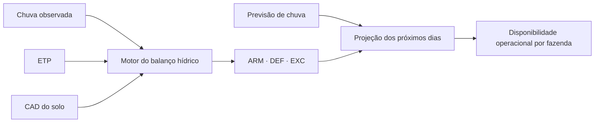

<h1 align="center">PARSEC</h1>

<p align="center">
  <b>Inteligência hídrica para decidir quando a lavoura pode operar</b><br>
  Balanço hídrico + chuva + previsão → disponibilidade operacional por fazenda
</p>

<p align="center">
  
  
  
</p>

---

## O problema

Entrar com máquina em solo encharcado compacta o terreno, atola equipamento e desperdiça hora de operação. Ficar parado com o solo pronto também custa caro. A pergunta "dá pra operar amanhã nessa fazenda?" costuma ser respondida no olho, porque a maioria dos produtores não tem estação meteorológica nem ferramenta que traduza chuva em umidade do solo.

## O que o PARSEC faz

1. Calcula, dia a dia, **quanta água há no solo** de cada fazenda com o balanço hídrico sequencial.
2. Combina a chuva observada com a **previsão** para projetar os próximos dias.
3. Traduz o resultado em **disponibilidade operacional**: onde e quando a operação é viável.

O PARSEC é gratuito e não usa dados de nenhuma empresa. Só dados públicos e os que o próprio usuário informar.

## Como funciona



## Método

O motor implementa o balanço hídrico sequencial de **Thornthwaite & Mather (1955)**, em passo diário e separado por unidade (fazenda).

| Variável | Significado |
|---|---|
| `P` | Chuva do dia (mm) |
| `ETP` | Evapotranspiração potencial (mm) |
| `CAD` | Capacidade de água disponível do solo (mm) |
| `NEG_AC` | Negativo acumulado: soma das perdas sem reposição |
| `ARM` | Água armazenada no solo (mm) |
| `ALT` | Variação do armazenamento em relação ao dia anterior |
| `ETR` | Evapotranspiração real |
| `DEF` | Deficiência hídrica |
| `EXC` | Excedente hídrico |

**Quando `P − ETP < 0` (o solo perde água):**

```
NEG_AC = NEG_AC(anterior) + (P − ETP)
ARM    = CAD × e^(NEG_AC / CAD)
```

**Quando `P − ETP ≥ 0` (o solo repõe água):**

```
ARM    = mín(ARM(anterior) + (P − ETP), CAD)
NEG_AC = CAD × ln(ARM / CAD)
```

**Em seguida:**

```
ALT = ARM − ARM(anterior)
ETR = ETP                 se P − ETP ≥ 0
ETR = P + |ALT|           se P − ETP < 0
DEF = ETP − ETR
EXC = (P − ETP) − ALT     se ARM = CAD; senão 0
```

### Regras de negócio

- Chuva abaixo de **0,5 mm** é tratada como zero: não chega a repor o solo.
- O armazenamento inicial de cada unidade é igual à sua `CAD`.
- O estado do dia anterior é sempre o **da mesma unidade**. Os dados são ordenados por unidade e data, e uma fazenda nunca herda o saldo de outra.
- Uma ETP faltante não interrompe o processamento: ela é estimada pela média da unidade, da região ou do dia.

## Roadmap

- [x] Motor do balanço hídrico sequencial em Python
- [ ] Ingestão automática de chuva observada
- [ ] Integração com previsão de chuva
- [ ] Regras de disponibilidade operacional (classes por fazenda)
- [ ] Protótipo mobile
- [ ] Hospedagem gratuita para uso aberto

## Telas

> Em breve.

## Referência

THORNTHWAITE, C. W.; MATHER, J. R. *The water balance*. Centerton, NJ: Drexel Institute of Technology, Laboratory of Climatology, 1955. (Publications in Climatology, v. 8, n. 1).

## Autor

**João Victor da Silva**: planejamento, dados e inteligência climática no agro.
[LinkedIn](https://www.linkedin.com/in/joaovictorslv) · [GitHub](https://github.com/joaovictorss04)
